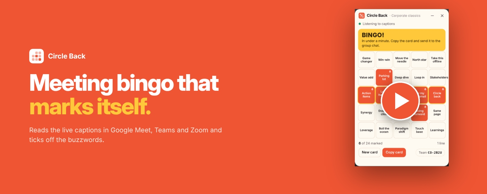
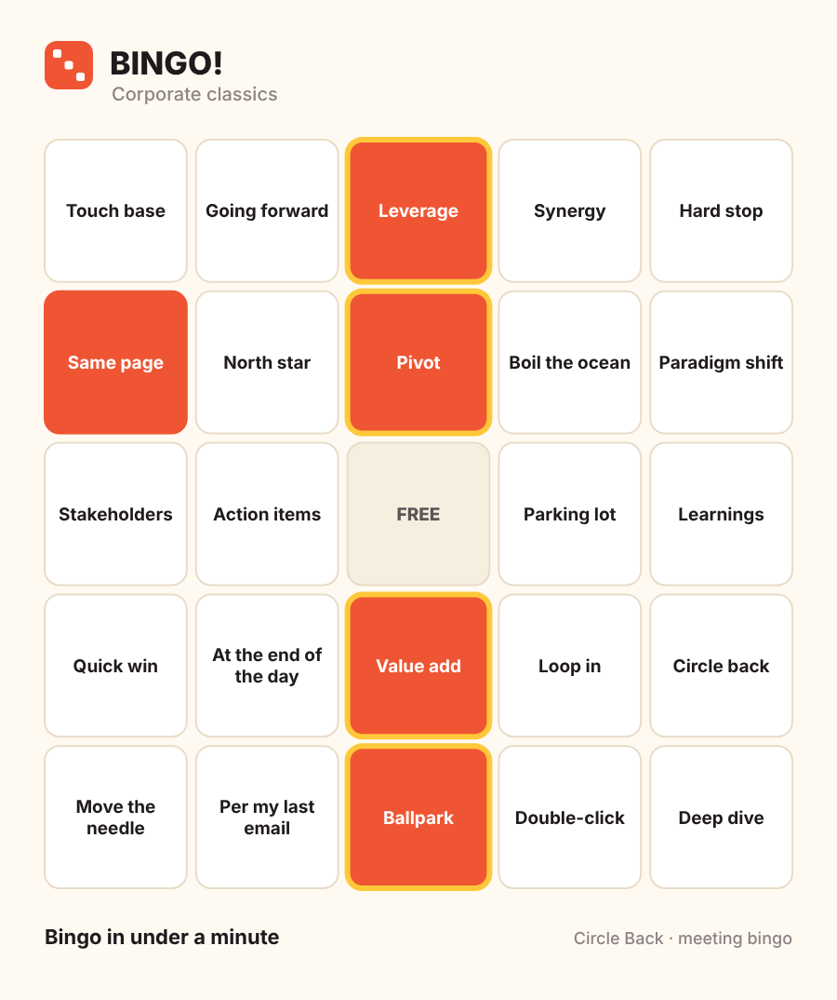
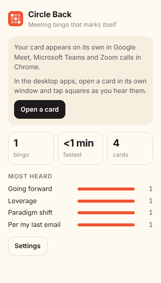
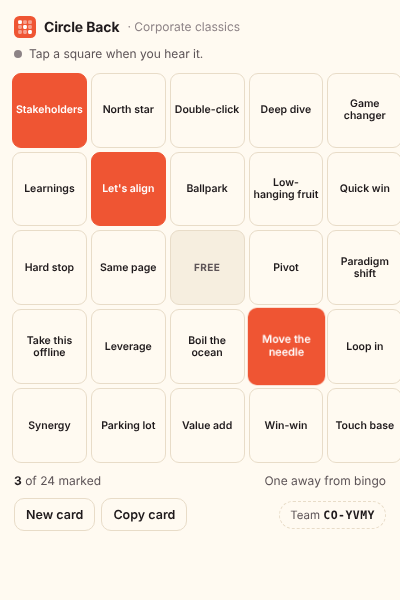
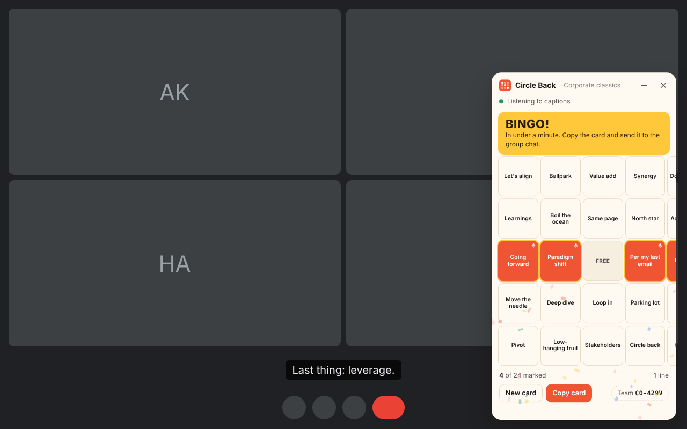

# Circle Back

[](https://chromewebstore.google.com/detail/einjddabkmeifhncghkdmjekhcohplkf) [](https://chromewebstore.google.com/detail/einjddabkmeifhncghkdmjekhcohplkf)

Meeting bingo that marks itself. A Chrome extension that puts a bingo card on your Google Meet, Microsoft Teams or Zoom call and ticks off the buzzwords as people say them, by reading the meeting's live captions.

<a href="https://www.youtube.com/watch?v=30JAGizVGGU"></a>

▶ [Watch the demo on YouTube](https://www.youtube.com/watch?v=30JAGizVGGU)

## How you'd use it

- **The weekly all-hands.** Turn on captions, leave the card minimised in the corner and get on with the meeting. When "synergy", "circle back" and "north star" land in a row, a quiet BINGO pops up.
- **With your team.** One person deals a card and shares the team code (like `CO-7KQ2`) in the chat. Everyone who enters it gets a card from the same phrase pack, but each card is different. First to bingo posts their card.
- **Stand-ups.** The Engineering stand-up pack listens for "blocked", "works on my machine", "should be a quick fix" and "merge conflict".
- **Sales and client calls.** "Does that make sense?", "next steps", "pain point", "ROI".
- **Your own in-jokes.** Write a pack of your team's catchphrases in settings.
- **Meetings in the desktop app.** Open a card in its own small window from the toolbar and tap the squares yourself.

When you hit bingo, **Copy card** puts an image of your card on the clipboard to paste into Slack or Teams:



## What's in it

- **Marks itself.** Squares light up when their phrase appears in the live captions, with a small microphone on squares the captions caught. You can always tap squares too.
- **Understands how people talk.** "You're on mute", "you are muted" and "YOU'RE ON MUTE!" all count. Each phrase lists the common ways of saying it.
- **Four phrase packs plus your own:** Corporate classics, Remote-work fails, Engineering stand-up and Sales call.
- **Stays out of the way.** Drag it anywhere, minimise it to a small pill, or hide it for the rest of the meeting. It remembers where you put it.
- **Survives a reload.** Your card stays the same if the meeting page reloads.
- **Stats.** Bingos, your fastest bingo, and the phrases you hear most, in the toolbar popup.
- **Quiet.** No sounds, ever. You're in a meeting.

<p>


</p>



## Privacy

Full policy: [PRIVACY.md](PRIVACY.md).

- Captions are read and matched on your computer only. Nothing is recorded, stored or sent anywhere.
- The only things saved are your settings, your card for the current meeting, and counts of which phrases you've heard.
- The extension doesn't use the microphone and has no access to any site other than Meet, Teams and Zoom.
- No accounts, no servers, no analytics.

## Install

**[Add to Chrome from the Chrome Web Store](https://chromewebstore.google.com/detail/einjddabkmeifhncghkdmjekhcohplkf)**. Then join a Google Meet, Teams or Zoom call in Chrome and turn on captions. Your card appears in the bottom-right corner.

To build from source instead:

```bash
npm install
npm run build
```

1. Open `chrome://extensions` and turn on **Developer mode**.
2. Click **Load unpacked** and choose the `dist` folder.
3. Join a Google Meet, Teams or Zoom call in Chrome and turn on captions. Your card appears in the bottom-right corner.

| App | How to turn on captions |
| --- | --- |
| Google Meet | The **CC** button, or press **C** |
| Microsoft Teams (web) | **More**, then **Language and speech**, then live captions |
| Zoom (web client) | The **CC** / **Captions** button |

## How it works

```
content.ts            runs on Meet, Teams and Zoom; shows the card during calls and scans captions every 0.8 s
lib/platforms.ts      where each app puts its captions and how to tell you're in a call
lib/match.ts          normalises caption text and matches phrases as whole words
lib/game.ts           seeded 5×5 cards, team codes, bingo lines
lib/packs.ts          the phrase packs
ui/                   the card (shared by the overlay and the pop-out window), confetti, card image
popup/ card/ options/ toolbar popup, pop-out card window, settings
```

Meeting apps change their pages from time to time. All caption selectors live in `src/lib/platforms.ts` and prefer accessibility attributes and test IDs over styling class names, so a fix is usually one line there. If captions aren't found, the card says so and tapping still works.

## Development

```bash
npm run watch      # rebuild on change, then reload the extension in chrome://extensions
npm test           # unit tests (vitest)
npm run typecheck  # tsc --noEmit
npm run zip        # package dist/ as circle-back.zip for the Chrome Web Store
```

## License

MIT
